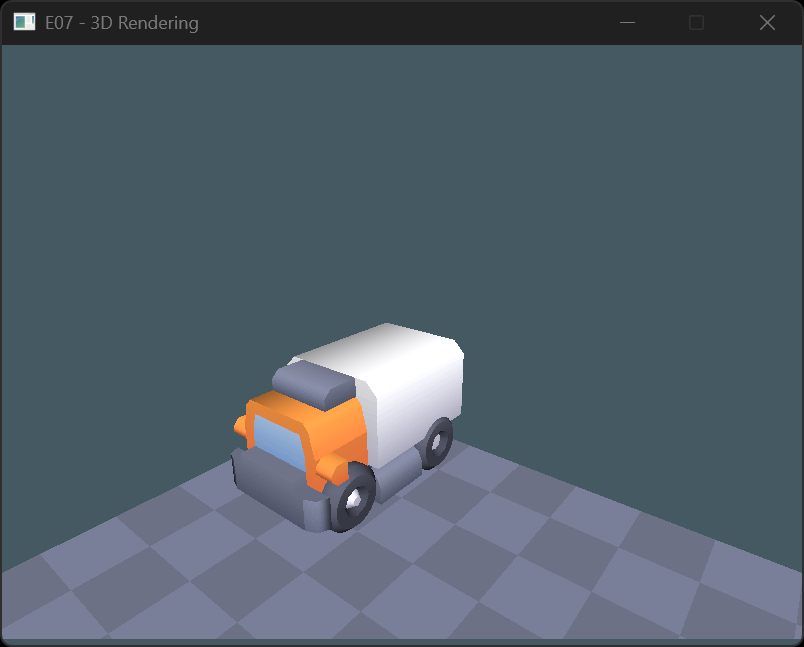

# Exercise 08 - Client-side 3D Rendering
Welcome ot the last exercise! This exercise will focus on manipulating 3D objects and camera, in order to render them appropriately.
Actual low-level rendering (graphics API, shaders and so on) will be the focus of next semester, during Graphics Programming.

## 8.1 Create a first-person camera
We will start creating a single forst-person camera controller. Don't worry of at the beginning it seems confusing, it's part of the process! (In fact, vefore starting you probably want to stop the reference object from rotating to keep things simple).
Starting creating two `glm::vec3` for camera movement and rotation, then every frame:
1. update them from user input
2. combine them in a "view matrix"
3. apply the vew matrix using `itu_sys_render3d_set_camera_view`

More precisely:
- map keyboard inputs to move the camera forward/backward and left/right
  Remember that the current renderer uses openGL/Vulkan orientation, so:
  - right is the positive X axis
  - left  is the negative X axis
  - forward  is the **negative** Z axis
  - backward is the **postive** Z axis
- map mouse movement (you can read`EngineContext::mouse-delta`) to rotate the camera. There are many ways to rotate a matrix in `glm`, but for this task you probably want to focus on the various `glm::aulerAngles` functions)
  A couple of things that you will need to keep into account:
  - which mouse axis correspond to which world axis? (we are mapping from 2D to 3D. think how camera rotation works in your favourite 1st person game)
  - what is the most intuitive order of rotations?
  - what is the correct order of application of movement and rotation?
